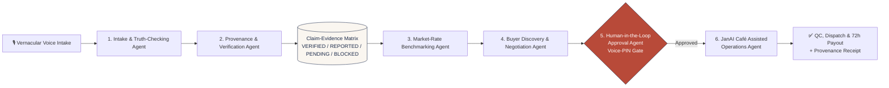

[readme.md](https://github.com/user-attachments/files/35175404/readme.md)
&lt;div align=&quot;center&quot;&gt;

# 🧵 LoomLink

### *The Weaver Keeps the Story. The Weaver Keeps the Price.*

**Voice-first, zero-hallucination agentic commerce for India’s handloom clusters.**

[](https://loomlink.ai.studio)
[](https://loomlink.ai.studio)
[](https://loomlink.ai.studio)
[](https://github.com/starrock7205-pixel/Loom-Link-)

&lt;br /&gt;

[**🚀 Open Live Prototype (`loomlink.ai.studio`)**](https://loomlink.ai.studio) &nbsp;•&nbsp; [**📦 GitHub Repository (`Loom-Link-`)**](https://github.com/starrock7205-pixel/Loom-Link-)

&lt;/div&gt;

---

## 1. The Problem — *Problem Statement 7.1*

> *“Artisans and weavers depend on middlemen and rarely reach buyers who value their craft.”*

**The weaver creates the value. The middleman captures the margin.**

- **Middleman Dependency:** Artisans rely on traders and master weavers for yarn credit, design cues, and market access.
- **Digital & Language Barriers:** Conventional e-commerce assumes English literacy, studio photography, SKU cataloguing, and self-managed logistics.
- **Erased Craft Identity:** By the time a saree reaches an urban rack, the maker’s name, village, and craft story disappear.
- **Blind Bulk Negotiation:** Bulk orders are negotiated without retail price benchmarks or transparent cost floors.
- **Generational Exit:** Low household returns push younger family members out of the loom and into informal wage labour.

### Where Value & Attribution Leak

```
┌─────────────┐     ┌──────────────────────────┐     ┌──────────────┐     ┌──────────────┐     ┌───────────┐
│   Artisan   │ ──▶ │  Trader / Master Weaver  │ ──▶ │  Wholesaler  │ ──▶ │ Urban Retail │ ──▶ │   Buyer   │
│ Weaves silk │     │ Aggregates cluster stock │     │ Strips story │     │ Adds markup  │     │ ₹9.5k–11k │
└─────────────┘     └──────────────────────────┘     └──────────────┘     └──────────────┘     └───────────┘
```

---

## 2. Following the Money — *Illustrative Gadwal Cotton-Silk Saree*

> **A ₹10,000 saree should not leave the weaver with ₹1,200.**

| Value-Chain Stage | Illustrative Amount (INR) | Share / Role |
| :--- | :---: | :--- |
| **Raw materials** | ₹3,200 | Yarn & zari inputs |
| **Weaver household labour** | **₹1,200** | ~12% of final retail |
| **Local aggregation** | ₹800–₹1,400 | Cluster collection |
| **Wholesale / distribution** | ₹1,600–₹1,700 | Multi-tier transit |
| **Urban retail** | ₹2,500–₹3,200 | Storefront & brand margin |
| **Final retail price** | **₹9,500–₹11,000** | Buyer checkout price |

> *Disclaimer: Illustrative pilot baseline based on published cluster benchmarks and local validation assumptions.*

---

## 3. Why Existing Solutions Fail

| Dimension | Generic E-Commerce Platforms | Generic AI Chatbots | **LoomLink** |
| :--- | :--- | :--- | :--- |
| **Onboarding** | English forms, studio photos, SKU tools | Unstructured chat prompts | **Voice-first intake** (Telugu, Kannada, Hindi, English) |
| **Truth & Claims** | Unverified seller text | Can hallucinate GI tags, pure silk, natural dyes | **Zero-hallucination Claim-Evidence Matrix** |
| **Pricing Power** | Race-to-the-bottom price wars | No cost-floor awareness | **Itemized floor price** + market benchmarks |
| **Final Authority** | Platform algorithms | Autonomous or unclear | **100% Artisan HITL Voice-PIN approval** |

---

## 4. Six-Agent System Architecture

> *Not a chatbot. A commerce agent that speaks the weaver’s language.*



### Agent Responsibilities

| # | Agent | Core Responsibility | Hard Guardrail |
| :-: | :--- | :--- | :--- |
| **1** | **Intake & Truth-Checking Agent** | Captures spoken craft attributes in regional languages | Never auto-upgrades stated claims to Verified |
| **2** | **Provenance & Verification Agent** | Builds the Evidence Pack (photos, yarn bills, cluster ID) | Blocks unverified GI, Handloom Mark, and silk claims |
| **3** | **Market-Rate Benchmarking Agent** | Computes itemized floor price & retail benchmarks | Explains every rupee in the weaver’s language |
| **4** | **Buyer Discovery & Negotiation Agent** | Matches verified listings with boutique & B2B buyers | Cannot accept offers below the artisan floor price |
| **5** | **Human-in-the-Loop Approval Agent** | Enforces Artisan Voice-PIN confirmation | Zero autonomous order or price commitments |
| **6** | **JanAI Café Assisted Operations Agent** | Coordinates local photography, QC, packaging, dispatch | Logistics support only; no financial authority |

---

## 5. End-to-End 9-Step Workflow

```
Voice intake ──▶ Truth-checking ──▶ Evidence pack ──▶ Market benchmarking ──▶ Price proposal
                                                                                   │
Payment & provenance receipt ◀── QC & dispatch ◀── Artisan approval ◀── Buyer negotiation
```

---

## 6. Zero-Hallucination Trust Architecture

> **AI must never invent the weaver’s truth.**

GI tags, Handloom Mark, pure silk, natural dye, and handloom claims **cannot be displayed as verified without evidence**.

| Status | Meaning | Rule |
| :--- | :--- | :--- |
| 🟢 **`VERIFIED`** | Backed by evidence | Supported by loom photo, yarn invoice, or cluster registry |
| 🔵 **`ARTISAN-REPORTED`** | Stated by the weaver | Preserved in the weaver’s own words; never silently upgraded |
| 🟡 **`PENDING`** | Awaiting verification | Queued for JanAI Café or cooperative check |
| 🔴 **`BLOCKED`** | Unsupported or contradictory | Automatically withheld from buyer-facing listings |

---

## 7. Loom Dost — *Voice-Guided Companion*

> **Loom Dost explains every rupee in the weaver’s own language.**

- Speaks **Telugu, Kannada, Hindi, or English**
- Highlights the relevant button or price on screen while explaining
- Clarifies evidence, GI status, floor price, buyer offers, and approvals
- **Never scrolls, submits, approves, or makes decisions automatically**

```text
Loom Dost : “This is your floor price: ₹5,400. Do not accept less unless you choose to.”
Artisan   : “Why ₹5,400?”
Loom Dost : “₹3,200 is yarn. ₹2,200 is your family’s work. ₹350 is delivery.”
```

---

## 8. Rural-First Design

- **Voice-First Vernacular UI:** Spoken prompts replace dense English forms.
- **Low-Literacy-Friendly UI:** Large tap targets, clear icons, and color-coded status badges.
- **Offline / Low-Network States:** Queues voice notes and loom photos locally until sync resumes.
- **Role-Based Access Control (RBAC):**
  - **Household Handler:** Family member can photograph and upload drafts without holding price authority.
  - **Artisan Voice-PIN Authority:** Only the primary weaver’s Voice-PIN can approve a floor price or buyer offer.
  - **JanAI Café Operator Support:** Village-level assisted hub for lighting, QC, packaging, and dispatch.

---

## 9. Business Model & Illustrative Unit Economics

> **Zero upfront fee for artisans. Sustainable value for the cluster.**

**North Star Metric:** *Artisan net realization per product and percentage of final retail price retained by the artisan household.*

| Revenue Streams | Illustrative Unit Economics | Value |
| :--- | :--- | :---: |
| • Buyer-side service fee | Production cost | ₹4,400 |
| • B2B sourcing fee | Artisan floor price | ₹5,400 |
| • Cooperative / cluster SaaS | Direct verified retail price | ₹7,800 |
| • ONDC enablement | **Artisan net realization** | **₹6,514** |
| • Premium provenance / traceability | Trader-led baseline labour | ₹1,200 |
| | **Modelled net labour uplift** | **+176%** |
| | **Retail retained** | **83.5%** |

> *Disclaimer: Illustrative model. To be validated through the 90-day Gadwal/Narayanpet pilot.*

---

## 10. 90-Day Pilot Roadmap

> **From Gadwal to a scalable craft-commerce OS.**

| Phase | Timeline | Scope |
| :--- | :--- | :--- |
| **Phase 1** | **Days 1–30** | Onboard 25–50 households, conduct field interviews, calibrate voice & pricing |
| **Phase 2** | **Days 31–60** | Publish 100 listings, onboard 5–10 boutique buyers |
| **Phase 3** | **Days 61–90** | Run one cooperative-led bulk-order pilot |

**Pilot Success Targets:**
- **25–35%** artisan net-realization uplift
- **Under 5%** return / dispute rate
- **100%** HITL approval compliance
- **Within 72 hours** artisan payout

---

## 11. Vision & Links

> **The loom should finally pay.**

LoomLink gives rural weavers a voice-first AI agent that turns craft knowledge into verified provenance, defensible prices, and buyer-ready orders—while the artisan, not the algorithm, makes every final commitment.

- **Live Web App:** https://loomlink.ai.studio
- **GitHub Repository & README:** https://github.com/starrock7205-pixel/Loom-Link-

---

&lt;div align=&quot;center&quot;&gt;
  &lt;sub&gt;Built by &lt;strong&gt;Team Ryomen Sukuna&lt;/strong&gt; for &lt;strong&gt;Tech4Bharat: GAVS Hackathon 2026&lt;/strong&gt; • Theme 07 • Problem Statement 7.1&lt;/sub&gt;
&lt;/div&gt;
