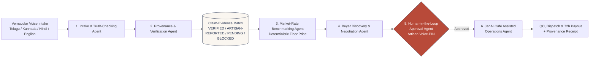
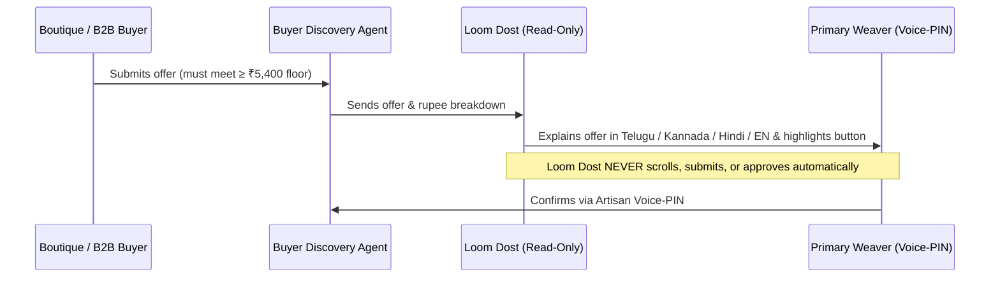

🧵 LoomLink

**Voice-first, zero-hallucination agentic commerce for rural Indian handloom weavers.**

[](https://loomlink.ai.studio) [](https://loomlink.ai.studio) [](https://loomlink.ai.studio) [](https://github.com/starrock7205-pixel/Loom-Link-) [](#19-license)

- **Live Prototype:** https://loomlink.ai.studio
- **GitHub Repository:** https://github.com/starrock7205-pixel/Loom-Link-

---

## 1. Problem Statement

**Tech4Bharat: GAVS Hackathon 2026 — Theme 07 (Arts, Crafts, Heritage & Talent) | Problem Statement 7.1:**
> *“Artisans and weavers depend on middlemen and rarely reach buyers who value their craft.”*

**The weaver creates the value. The middleman captures the margin.**
- Artisans depend on traders and master weavers for yarn credit, design cues, and market access.
- Conventional e-commerce assumes English literacy, studio photography, SKU cataloguing, and digital confidence.
- The maker’s name, village, and craft story disappear across a 5-hop intermediary chain (`Artisan → Trader / Master Weaver → Wholesaler → Urban Retail → Buyer`).
- Bulk orders are negotiated blindly without retail benchmarks, pushing younger family members out of the craft.

---

## 2. Solution Overview

**LoomLink** is a voice-first, evidence-gated agentic commerce platform where **the weaver keeps the story and the weaver keeps the price**:
- **Vernacular Voice Intake:** Weavers speak craft details in Telugu, Kannada, Hindi, or English—no typing or English cataloguing required.
- **Zero-Hallucination Provenance:** Every claim (GI tag, Handloom Mark, pure silk, natural dye) is strictly gated by physical or documentary evidence.
- **Deterministic Pricing & HITL Control:** Floor prices are computed transparently, explained by **Loom Dost**, and locked only via the primary weaver’s **Artisan Voice-PIN**.
- **Assisted Village Operations:** Local **JanAI Café** operators support studio photography, quality checks, packaging, and dispatch without holding financial authority.

---

## 3. Six-Agent Architecture Diagram



| # | Agent | Core Responsibility | Guardrail |
| :-: | :--- | :--- | :--- |
| **1** | **Intake & Truth-Checking Agent** | Captures spoken craft attributes in regional voice | Never auto-upgrades stated claims to Verified |
| **2** | **Provenance & Verification Agent** | Assembles Evidence Pack (loom photos, yarn bills, cluster ID) | Blocks unverified GI, Handloom Mark, and silk claims |
| **3** | **Market-Rate Benchmarking Agent** | Computes deterministic floor price and retail benchmarks | Itemizes every rupee in plain language |
| **4** | **Buyer Discovery & Negotiation Agent** | Matches verified listings with boutique and B2B buyers | Cannot accept offers below the artisan floor price |
| **5** | **Human-in-the-Loop Approval Agent** | Enforces Artisan Voice-PIN confirmation | Zero autonomous price or order commitments |
| **6** | **JanAI Café Assisted Operations Agent** | Coordinates local photography, QC, packaging, and dispatch | Logistics support only; no financial authority |

---

## 4. Zero-Hallucination Claim-Evidence Matrix

> **AI must never invent the weaver’s truth.**

GI tags, Handloom Mark, pure silk, natural dye, and handloom claims **cannot be displayed as verified without evidence**.

| Status | Meaning | Enforcement Rule | Example Gate |
| :--- | :--- | :--- | :--- |
| **VERIFIED** | Backed by evidence | Displayed with provenance badge | Loom geo-photo + yarn invoice |
| **ARTISAN-REPORTED** | Stated by the weaver | Preserved in weaver’s words; never silently upgraded | Self-reported weave hours or dye note |
| **PENDING** | Awaiting verification | Queued for JanAI Café or cooperative check | Submitted GI registration ID |
| **BLOCKED** | Unsupported or contradictory | Automatically withheld from buyer listings | Unbacked Handloom Mark claim |

---

## 5. Deterministic Pricing Formula

LoomLink never lets an LLM guess or negotiate a price blindly. Floor prices are computed deterministically from verified inputs:

```text
Production Cost     = Yarn & Zari Cost + Dye / Consumables
Artisan Floor Price = Production Cost + Family Labour Value + Packaging & Local Margin Floor
Net Realization     = Direct Verified Retail Price - (Logistics + Platform / Buyer-Side Service Fee)
```

**Illustrative Gadwal Cotton-Silk Saree Comparison** *(Illustrative model; to be validated in the 90-day pilot)*:

| Metric | Trader-Led Baseline (Illustrative) | LoomLink Direct Model (Illustrative) |
| :--- | :---: | :---: |
| Production / Raw Material Cost | ₹3,200 (yarn) | ₹4,400 (total production cost) |
| Artisan Floor Price | — | **₹5,400** |
| Final / Direct Verified Retail | ₹9,500–₹11,000 | **₹7,800** |
| Artisan Net Realization / Labour | ₹1,200 (~12%) | **₹6,514 (83.5% retail retained)** |
| Modelled Net Labour Uplift | Baseline | **+176% (illustrative)** |

---

## 6. Human-in-the-Loop (HITL) Approval Flow



- **Role-Based Access Control (RBAC):** Younger **Household Handlers** or **JanAI Café Operators** can upload photos and drafts, but only the primary weaver’s **Artisan Voice-PIN** can lock a floor price or accept an order.

---

## 7. Loom Dost Companion

> **Loom Dost explains every rupee in the weaver’s own language.**

- Speaks **Telugu, Kannada, Hindi, or English**
- Highlights the relevant button or price on screen while speaking
- Explains evidence status, GI tag state, floor price, buyer offers, and approvals
- **Never scrolls, submits, approves, or makes decisions automatically**

```text
Loom Dost : “This is your floor price: ₹5,400. Do not accept less unless you choose to.”
Artisan   : “Why ₹5,400?”
Loom Dost : “₹3,200 is yarn. ₹2,200 is your family’s work. ₹350 is delivery.”
```

---

## 8. JanAI Café Assisted Operations Workflow

```text
1. Weaver arrives / requests pickup ──▶ 2. JanAI Café captures studio-lit loom & saree photos
3. Physical QC & yarn/GI document scan ──▶ 4. Evidence Pack attached to listing
5. Buyer order approved via Voice-PIN ──▶ 6. JanAI Café packages & dispatches with provenance receipt
```

---

## 9. Tech Stack

| Layer | Technologies |
| :--- | :--- |
| **Frontend & Pitch UI** | Next.js (App Router), TypeScript, Tailwind CSS, shadcn/ui, Framer Motion, Lucide Icons |
| **Voice & Agentic Layer** | Vernacular Speech-to-Text / Text-to-Speech, Structured Tool-Calling Agents, Deterministic Pricing Engine |
| **Trust & Governance** | 4-State Claim-Evidence Matrix, RBAC (Household Handler / JanAI Café / Artisan Voice-PIN) |
| **Commerce & Deployment** | ONDC-ready catalog schema, Vercel / Cloud deployment |

---

## 10. Screenshots & Demo Placeholders

> *Replace the paths below with exported screenshots or GIFs from `https://loomlink.ai.studio` before final submission.*

| Screen | Preview Placeholder |
| :--- | :--- |
| **Vernacular Voice Intake & Loom Dost** | `` |
| **Claim-Evidence Matrix & Evidence Pack** | `` |
| **Artisan Voice-PIN Approval Screen** | `` |
| **End-to-End Walkthrough GIF** | `` |

---

## 11. Local Setup Instructions

```bash
# 1. Clone the repository
git clone https://github.com/starrock7205-pixel/Loom-Link-.git
cd Loom-Link-

# 2. Install dependencies
npm install

# 3. Configure environment variables (if running with live API keys)
cp .env.example .env.local

# 4. Start the development server
npm run dev
```

Open `http://localhost:3000` in your browser.

---

## 12. Simulated APIs Disclosure

To ensure transparent judging during the hackathon prototype phase:
- **Simulated in Prototype:** ONDC network settlement calls, automated GI Registry API lookups, telecom Voice-PIN SMS/IVR gateway callbacks, and live courier tracking webhooks are currently mocked/simulated in the prototype environment.
- **Live / Deterministic in Prototype:** Multi-agent state transitions, the 4-state Claim-Evidence Matrix gating logic, deterministic floor-price calculations, RBAC role separation, and Loom Dost multilingual explanations.
- **No Completed Field Claims:** All unit economics and cluster baselines are **illustrative models** pending validation during the 90-day pilot.

---

## 13. 90-Day Pilot Roadmap

> **From Gadwal to a scalable craft-commerce OS.**

| Phase | Timeline | Milestones |
| :--- | :--- | :--- |
| **Phase 1** | **Days 1–30** | Onboard 25–50 households in Gadwal/Narayanpet, conduct field interviews, calibrate voice & pricing |
| **Phase 2** | **Days 31–60** | Publish 100 evidence-backed listings, onboard 5–10 boutique buyers |
| **Phase 3** | **Days 61–90** | Run one cooperative-led bulk-order pilot end to end |

---

## 14. Business Model

**Zero upfront fee for artisans. Sustainable value for the cluster.**

**North Star Metric:** *Artisan net realization per product and percentage of final retail price retained by the artisan household.*

- **Buyer-side service fee** on verified direct orders
- **B2B sourcing fee** for boutique and institutional bulk orders
- **Cooperative / cluster SaaS** for inventory and provenance management
- **ONDC enablement** for interoperable network discovery
- **Premium provenance / traceability** verification packages

---

## 15. Target Impact Metrics *(To Be Validated in 90-Day Pilot)*

| Metric | Target |
| :--- | :---: |
| **Artisan net-realization uplift** | **25–35%** |
| **Return / dispute rate** | **Under 5%** |
| **HITL approval compliance** | **100%** |
| **Artisan payout window** | **Within 72 hours** |

---

## 16. Team

- **Team Name:** **Ryomen Sukuna**
- **Hackathon:** Tech4Bharat: GAVS Hackathon 2026
- **Track:** Theme 07 — Arts, Crafts, Heritage & Talent (Problem Statement 7.1)
- **Live Prototype:** https://loomlink.ai.studio
- **Repository:** https://github.com/starrock7205-pixel/Loom-Link-

---

## 17. License

This project is licensed under the **MIT License** — see the [LICENSE](https://www.google.com/search?q=./LICENSE) file for details.md…]()
